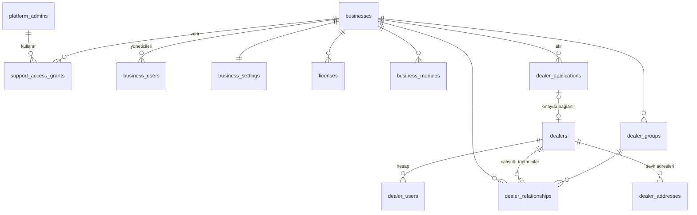
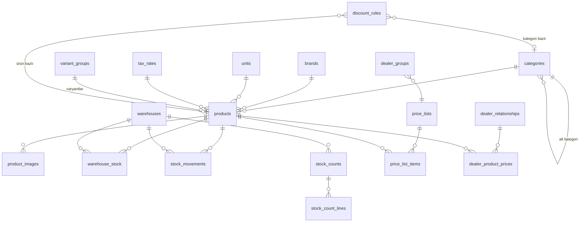
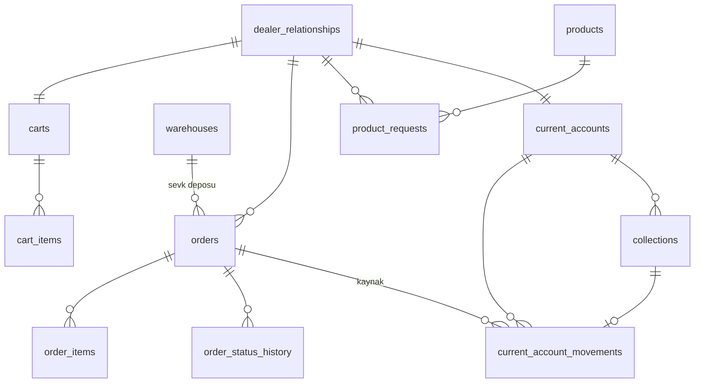

# Aşama 1 — Veritabanı Tasarımı ve ER Diyagramı

> MySQL 8 · InnoDB · `utf8mb4_turkish_ci` (Türkçe sıralama ve arama için)
> Durum: **Onaylandı** (2026-10-15)

## Genel kurallar

- Birincil anahtar: `BIGINT UNSIGNED AUTO_INCREMENT`. Dışarıya gösterilen numaralar ayrı alandır (`order_no`, `dealer_code`); kayıt ID'si URL'de olsa bile tenant kapsamı nedeniyle tahmin edilmesi işe yaramaz.
- İşletmeye ait her tabloda `business_id` (NOT NULL, indeksli). Sık sorgulanan indeksler `business_id` ile başlar.
- Para: tutarlar `DECIMAL(15,2)`, birim fiyatlar `DECIMAL(15,4)`, oranlar `DECIMAL(5,2)`, miktarlar `DECIMAL(14,3)` (birim izin vermiyorsa küsurat doğrulamada reddedilir).
- Zaman damgaları: `created_at`, `updated_at` (UTC saklanır, Europe/Istanbul gösterilir).
- Silme: ticari kayıtlar silinmez. Ürün/bayi/kategori `archived_at` ile arşivlenir. Stok ve cari hareketleri **yalnızca eklenir** (append-only); düzeltme ters kayıtla yapılır.
- Tekrarlanan işlem koruması: hareket tablolarında `source_key` sütunu + `UNIQUE` kısıt (ör. `order:812:sale:item:3`). Aynı işlem ikinci kez yazılmaya çalışılırsa veritabanı reddeder.
- `CHECK` kısıtları MySQL 8.0.16+ ile uygulanır (ör. `warehouse_stock.quantity >= 0`).

---

## A. Kimlik, işletme ve platform

| Tablo | Amaç | Önemli alanlar / kısıtlar |
|---|---|---|
| `platform_admins` | Platform yöneticileri (ayrı guard) | email UNIQUE, password, `two_factor_secret` (şifreli), is_active |
| `businesses` | Toptancı işletme (tenant) | slug UNIQUE (başvuru URL'i), legal_name, tax_office, tax_number, iletişim, logo_path, accent_color, status `active/suspended/closed` |
| `business_settings` | İşletme davranış ayarları (1:1) | default_warehouse_id, stock_display `exact/level`, low_stock_threshold_mode, ledger_post_on `approval/completion`, default_payment_term_days, order_no_prefix, price_display `excl_vat/incl_vat` |
| `licenses` | Lisans dönemi | plan, starts_at, ends_at, max_dealers, max_products, status |
| `business_modules` | Modül aç/kapa | (business_id, module_key) UNIQUE, enabled |
| `business_users` | Toptancı giriş hesabı (**işletme başına tek kullanıcı**) | business_id **UNIQUE**, email **global UNIQUE**, password, status, two_factor_secret |
| `support_access_grants` | Süreli teknik destek izni | business_id, platform_admin_id, granted_by, reason, expires_at, revoked_at |
| `dealers` | Bayi işletmesi (toptancıdan bağımsız kimlik) | legal_name, tax_office, tax_number, telefon, e-posta, il/ilçe/adres |
| `dealer_users` | Bayi giriş hesabı (**bayi başına tek kullanıcı**) | dealer_id **UNIQUE**, email **global UNIQUE**, password (aktivasyona kadar NULL), activated_at, status |
| `dealer_relationships` | **Toptancı ↔ bayi ticari ilişkisi** — sipariş, fiyat, cari bunun üzerinden | (business_id, dealer_id) UNIQUE, (business_id, dealer_code) UNIQUE, dealer_group_id, status `active/suspended/closed`, payment_term_days, can_edit_addresses, approved_at/by |
| `dealer_groups` | Fiyat grubu (ör. "A Grubu Bayiler") | business_id, name, price_list_id |
| `dealer_applications` | Başvurular | business_id, firma/yetkili/iletişim/vergi alanları, business_type, activity_area, note, status (6 durum), consent_text_version, consent_at, ip, reviewed_by, decision_note, dealer_id (onayda) |
| `dealer_addresses` | Sevk adresleri | dealer_id, title, recipient_name, phone, city, district, address_line, note, is_default, archived_at |
| `auth_tokens` | Aktivasyon / parola sıfırlama | guard, user_id, purpose, token_hash UNIQUE, expires_at, used_at |

**Neden `dealers` ile `dealer_relationships` ayrı?** Bir bayi (Onur Kırtasiye) ileride hem Akgün hem başka bir toptancıyla çalışabilir. Bayi kimliği ve adresleri tek; ama her toptancıyla fiyatı, cari hesabı, siparişleri, bayi kodu ve durumu ayrı. Toptancı, bayinin diğer toptancılarla ilişkisini **göremez** (sorgular her zaman `dealer_relationships.business_id` üzerinden).

## B. Katalog, fiyat ve stok

| Tablo | Önemli alanlar / kısıtlar |
|---|---|
| `categories` | business_id, parent_id (en fazla 2 seviye), name, slug, sort, is_active |
| `brands` | business_id, name — (business_id, name) UNIQUE |
| `units` | business_id, code, name, allows_fraction (Adet, Koli, Paket, Kg…) |
| `tax_rates` | business_id, name, rate (%0 / %1 / %10 / %20 başlangıç), is_active. Oran değişirse yeni kayıt; eski siparişler etkilenmez |
| `variant_groups` | business_id, name, attribute_names (JSON, ör. `["Renk"]`) |
| `products` | business_id, sku, barcode, name, description, category_id, brand_id, model, unit_id, pack_quantity, purchase_price, list_price, dealer_price, tax_rate_id, price_includes_tax, min_order_qty, order_step, critical_stock_level, variant_group_id, variant_values (JSON), is_active, visible_to_dealers, archived_at. **UNIQUE (business_id, sku), UNIQUE (business_id, barcode)**. FULLTEXT (name, sku, barcode) — katalog araması |
| `product_images` | business_id, product_id, path, sort, is_primary |
| `warehouses` | business_id, code, name, is_active |
| `warehouse_stock` | business_id, warehouse_id, product_id, quantity — **UNIQUE (warehouse_id, product_id)**, `CHECK (quantity >= 0)`. Anlık stok; hareketlerin toplamına eşit olmak zorunda |
| `stock_movements` | business_id, warehouse_id, product_id, type, quantity (işaretli), balance_after, reference_type/id, transfer_uuid, note, actor, **source_key UNIQUE (nullable)**, created_at. Güncellenmez/silinmez |
| `stock_counts` / `stock_count_lines` | Sayım oturumu (draft → applied); satır: system_qty, counted_qty, difference. Uygulanınca fark kadar `count_adjust` hareketi |
| `price_lists` | business_id, name, starts_at, ends_at, is_active |
| `price_list_items` | price_list_id, product_id, price — UNIQUE (price_list_id, product_id) |
| `dealer_product_prices` | business_id, dealer_relationship_id, product_id, price, starts_at, ends_at |
| `discount_rules` | business_id, scope `product/category`, product_id / category_id, target `all/group/dealer`, dealer_group_id / dealer_relationship_id, percent, starts_at, ends_at, is_active |

`stock_movements.type`: `opening` (ilk giriş), `increase`, `decrease`, `sale` (sipariş onayı), `sale_reversal` (iptal), `return_in` (iade), `transfer_out`, `transfer_in`, `count_adjust`, `manual_adjust`. **Rezervasyon türü yoktur.**

## C. Sepet, sipariş, talep ve cari

| Tablo | Önemli alanlar / kısıtlar |
|---|---|
| `carts` | business_id, dealer_relationship_id UNIQUE |
| `cart_items` | cart_id, product_id, quantity — UNIQUE (cart_id, product_id). **Fiyat saklanmaz**, her görüntülemede hesaplanır |
| `orders` | business_id, order_no (UNIQUE per business), dealer_relationship_id, status, is_partial, submit_token **UNIQUE** (çift tıklama), warehouse_id, tutarlar (subtotal, discount_total, vat_total, grand_total), dealer_note, **sevk adresi anlık görüntüsü** (ship_title, ship_recipient, ship_phone, ship_city, ship_district, ship_address, ship_note), delivery_planned_on, delivery_note, approved_at/by, rejected_reason, stock_applied_at, stock_reversed_at, ledger_applied_at, ledger_reversed_at, cancel_requested_from (önceki durum), lock_version |
| `order_items` | order_id, business_id, product_id, **snapshot**: sku, barcode, name, unit_name, vat_rate, price_source; quantity_requested, quantity_approved, list_unit_price, unit_price (net, KDV hariç), discount_percent, line_discount, line_net, line_vat, line_total |
| `order_status_history` | order_id, from_status, to_status, actor_type/id, note, created_at |
| `product_requests` | business_id, dealer_relationship_id, product_id, quantity, note, status (6 durum), response_note, notify_when_in_stock, notified_at, responded_by/at |
| `current_accounts` | business_id, dealer_relationship_id UNIQUE, code (UNIQUE per business), balance (önbellek), currency `TRY` |
| `current_account_movements` | business_id, current_account_id, type, debit, credit, movement_date, due_date, order_id, collection_id, reverses_movement_id **UNIQUE**, description, actor, **source_key UNIQUE** |
| `collections` | business_id, current_account_id, collected_on, amount, method `cash/transfer/check/note/card_pos/other`, order_id, description, created_by, cancelled_at, cancel_reason |

`current_account_movements.type`: `opening`, `order_debit`, `collection`, `return_credit`, `adjustment_debit`, `adjustment_credit`, `reversal`.
Bakiye işareti: **pozitif = bayi borçlu** (toptancı alacaklı).

## D. İletişim, bildirim, rapor, sistem

| Tablo | Amaç / alanlar |
|---|---|
| `conversations` | business_id, dealer_relationship_id, subject, context_type `order/product_request/null`, context_id, last_message_at. Katılımcılar sabittir: işletme tarafı + ilgili bayi; ayrı `participants` tablosuna gerek yok |
| `messages` | conversation_id, business_id, sender_type `business_user/dealer_user`, sender_id, body (düz metin), created_at. FULLTEXT (body) — mesaj arama |
| `conversation_reads` | conversation_id, side `business/dealer`, last_read_message_id — okundu bilgisi |
| `attachments` | business_id, attachable_type/id (mesaj, başvuru), stored_path, original_name, mime, size, sha256, uploaded_by. Dosya `storage/app/private` altında |
| `announcements` | business_id, title, body, audience `all/group`, dealer_group_id, published_at, email_sent_at |
| `notifications` | recipient_type/id, business_id, type, data (JSON), read_at |
| `email_settings` | business_id UNIQUE, from_email, from_name, app_password_encrypted, status `unconfigured/verified/failed`, last_tested_at, last_error_code (yalnızca kod, ham sunucu cevabı değil) |
| `email_templates` | business_id (NULL = sistem varsayılanı), key, subject, intro_text — düz metin + izinli yer tutucular (`{bayi_adi}`, `{siparis_no}` …). Görsel düzen kodda sabit, işletme yalnızca metni değiştirir |
| `email_logs` | business_id, template_key, to_email, subject, related_type/id, status `queued/sent/failed/skipped_unconfigured`, attempts, last_error_code, sent_at |
| `audit_logs` | business_id (NULL = platform), actor_type/id, action, entity_type/id, old_values/new_values (JSON, hassas alanlar maskeli), ip, user_agent, created_at |
| `saved_report_filters` | business_id, owner_type/id, report_key, name, filters (JSON) |
| `export_jobs` | business_id, requested_by, report_key, format, filters, status, row_count, file_path, expires_at |
| `import_jobs` / `import_errors` | İçe aktarma oturumu; satır no, sütun, hata mesajı |
| `system_settings` | key UNIQUE, value (JSON) — platform geneli |
| `error_events` | fingerprint UNIQUE, level, message (temizlenmiş), first_seen, last_seen, count — platform "hata kayıtları" ekranı |
| `backup_runs` | started_at, finished_at, status, size_bytes, location |
| `jobs`, `failed_jobs`, `cache`, `sessions` | Laravel altyapı tabloları |

## Gereksinim listesinden çıkarılan / birleştirilen tablolar

| Önerilen tablo | Karar | Gerekçe |
|---|---|---|
| `product_variants` | `variant_groups` + ürün satırı | Her varyant zaten SKU, stok ve fiyat sahibi; ayrı matris tekrar ve tutarsızlık doğurur |
| `conversation_participants` | Kaldırıldı | Konuşma her zaman bir toptancı ↔ bir bayi; okundu bilgisi `conversation_reads` |
| `documents` | `attachments` ile birleşik | Tek güvenli dosya altyapısı |
| `platform_admins` vs ortak `users` | Ayrı tablolar (3 adet) | Üç giriş alanının teknik olarak karışamaması |
| `licenses` | Korundu | Platform paneli lisans takibi |
| Rezervasyon, kargo, fire tabloları | **Yok** | Kapsam dışı |

## Kritik indeksler

- `products (business_id, is_active, visible_to_dealers, category_id)`, `(business_id, brand_id)`, FULLTEXT `(name, sku, barcode)`
- `warehouse_stock (business_id, product_id)`
- `stock_movements (business_id, product_id, created_at)`, `(business_id, warehouse_id, created_at)`
- `orders (business_id, status, created_at)`, `(business_id, dealer_relationship_id, created_at)`
- `order_items (business_id, product_id)`
- `current_account_movements (current_account_id, movement_date)`, `(business_id, due_date)`
- `messages (conversation_id, id)`
- `audit_logs (business_id, created_at)`, `(entity_type, entity_id)`
