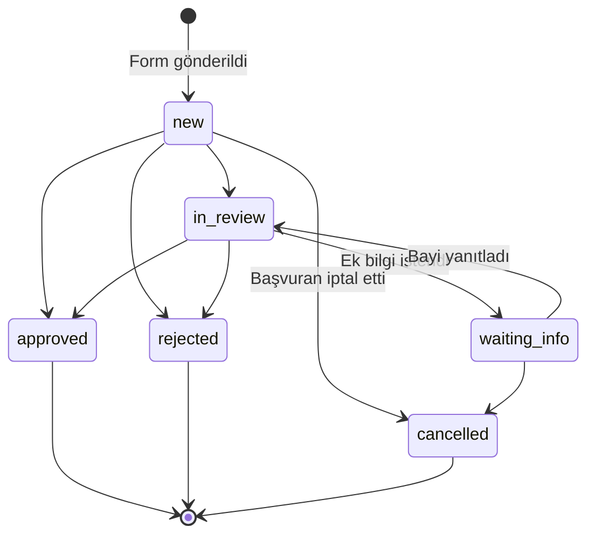

# Aşama 1 — İş Akışları ve Veri Tutarlılığı Kuralları

> Stok · Sipariş · Cari · Fiyat · Bayilik · Ürün talebi · E-posta
> Durum: **Onaylandı** (2026-10-15)

Bu kurallar kodun ve testlerin sözleşmesidir. Bir kural değişirse önce bu doküman güncellenir.

---

## 1. Bayilik başvurusu → bayi hesabı



1. Başvuru formu `/basvuru/{slug}` — rate limit (IP başına 5/saat), gizli bal küpü (honeypot) alanı, aydınlatma metni onayı ve metin sürümü kaydedilir. Belge eki isteğe bağlı (PDF/JPG/PNG, en fazla 5 MB, 3 dosya).
2. Aynı işletmeye aynı e-postayla açık (yeni / inceleniyor / ek bilgi) başvuru varsa yenisi oluşmaz.
3. **Onay** (tek transaction):
   - E-posta mevcut bir `dealer_users` kaydına aitse → mevcut `dealers` kullanılır (K11).
   - Değilse → `dealers` + `dealer_users` (parolasız) oluşturulur.
   - `dealer_relationships` (bayi kodu otomatik, işletme değiştirebilir) + `current_accounts` (bakiye 0) + boş `carts` oluşturulur.
   - Yeni hesapsa aktivasyon token'ı (72 saat, tek kullanım, yalnızca hash saklanır).
   - Başvuru `approved`, `audit_logs`.
   - Transaction **sonrası**: e-posta kuyruğa (aktivasyon linki veya "yeni toptancı bağlandı").
4. Red: gerekçe zorunlu; bayiye e-posta. Hesap oluşmaz.
5. Ret veya iptal edilmiş başvuru sahibi yeniden başvurabilir.

**Bayinin sipariş verebilmesi için:** `dealer_users.status = active` **ve** `dealer_relationships.status = active` **ve** `businesses.status = active`. Bu kontrol her istekte middleware'de ve sipariş Action'ında tekrar yapılır.

## 2. Stok

**Temel ilke:** `warehouse_stock.quantity` gerçek fiziksel stoktur ve yalnızca bir `stock_movements` kaydıyla **aynı transaction'da** değişir.

| Kural | Uygulama |
|---|---|
| S1 — Değişmezlik | Her (depo, ürün) için `warehouse_stock.quantity = SUM(stock_movements.quantity)`. Günlük kontrol görevi farkı raporlar (otomatik düzeltmez). |
| S2 — Negatif stok yok | Düşüm öncesi satır `FOR UPDATE` ile kilitlenir; yetersizse işlem reddedilir. Ayrıca `CHECK (quantity >= 0)`. |
| S3 — Hareketler silinmez | Yanlış hareket, ters yönlü yeni hareketle düzeltilir (açıklama + bağlantı). Tek istisna: ürünün kalıcı silinmesi (S9). |
| S4 — Transfer | Tek transaction: kaynak depoda `transfer_out` (−), hedefte `transfer_in` (+), aynı `transfer_uuid`. Kaynak yetersizse ikisi de yazılmaz. |
| S5 — Sayım | Sayım taslağı oluşturulurken sistem miktarı kopyalanır; **uygulama anında** fark yeniden hesaplanır (sayım sırasında satış olduysa doğru fark yazılır). Fark kadar `count_adjust`. |
| S6 — Kilit sırası | Birden çok stok satırı kilitlenirken her zaman `product_id` artan sırada (kilitlenme/deadlock önleme). |
| S7 — Sepet ve sipariş stok ayırmaz | Sepette olmak veya sipariş oluşturmak stoğu değiştirmez. Stok **yalnızca sipariş onayında** düşer. |
| S8 — Kritik stok | `quantity <= critical_stock_level` → dashboard ve "Kritik stok" raporu. |
| S9 — Ürünü kalıcı silme | Toptancı ürün sayfasından "Ürünü kalıcı sil" (`ProductService::delete`). Ürünün stok hareketleri, depo stoğu, sayım satırları, görselleri, sepet kayıtları, ürün talepleri, bayi özel fiyatları, fiyat listesi kalemleri ve ürün indirim kuralları birlikte silinir; kampanya kapsamından çıkarılır. Silinen stok miktarı ve hareket sayısı denetim kaydına yazılır. Sipariş kalemleri korunur (`product_id` boşaltılır; ad, kod, birim, fiyat ve KDV satırda kalır), böylece sipariş, cari ve rapor değişmez. Ürün karar bekleyen veya hazırlanan bir siparişte ya da açık bir iade talebindeyse silinmez. Silinmiş ürünün iadesinde tutar cariye / karta yazılır, stok girişi yapılmaz. Sipariş verme ile çakışmasın diye önce ürünün sepet satırları, sonra ürün satırı kilitlenir (sipariş verme ile aynı sıra). Arşivleme ve pasife alma ayrıca durur. |

**Bayiye gösterilen stok** = varsayılan sevk deposundaki miktar (K3). Gösterim biçimi işletme ayarı (K4).

### 2.1 Satış şekli (2026-11-04)

Fiyat, stok ve sipariş miktarı her zaman **adet** cinsindendir; koli yalnızca bayinin nasıl sipariş vereceğini belirleyen kuraldır. Toptancı ürün formunda üç şekilden birini seçer (`products.sale_mode`):

| Şekil | Toptancı girer | Kayıt | Bayi görür |
|---|---|---|---|
| Tek tek (`single`) | En az sipariş (genelde 1) | koli içi = 1, artış = 1 | "Tek tek satılır" / "Tek tek · en az 3 adet" |
| Koli halinde (`case`) | Koli içi adet (≥ 2), en az koli | artış = koli içi, en az = koli içi × en az koli | "Koli: 24 adet · en az 1 koli", ürün sayfasında koli fiyatı, sepette "N koli" |
| Özel kural (`custom`) | En az sipariş, artış | koli içi = 1; en az, artışın katı olmalı | "En az 15 adet, 15'er artar" |

- Miktarlar tam sayıdır. Sipariş doğrulaması değişmedi: `miktar ≥ min_order_qty` ve `miktar`, `order_step`'in katı (§3).
- **Birim yönetimi kaldırıldı:** "KDV ve Birimler" sayfası "KDV Oranları" oldu (`/toptanci/kdv-oranlari`; eski adres yönlendirilir). Yeni ürün her zaman adettir. Mevcut ürün birimini korur; stok hareketleri değiştirilemeyeceği için (S3) birim dönüştürülmez. `units` tablosu durur.
- Klasörden toplu eklenen ürün tek tek satılır (§2.4); satış şekli sonradan ürün ekranından değiştirilir.
- Geçişte mevcut ürünlerin şekli kurallarından aynı yöntemle çıkarıldı.

### 2.2 Ürün seçenekleri (2026-11-05)

Varyant grupları sayfası kaldırıldı. Renk, boyut gibi seçenekler ürünün kendisinden yönetilir (mağaza yönetimindeki gibi):

- Ürün formunda **Seçenek adı** (ör. Renk) ve **değeri** (ör. Kırmızı) vardır; tek seçenekli üründe ikisi de boş kalır (`products.option_name`, `option_value`).
- Ürün sayfasındaki **Seçenekler** kartından "Yeni seçenek ekle" denir: form kaynak ürünün bilgileriyle (ad, kategori, marka, açıklama, fiyatlar, KDV, satış şekli) dolu gelir; ürün kodu, barkod ve değer girilir. Kaynağın henüz değeri yoksa bir kez sorulur (`ProductService::createOption`).
- Her seçenek kendi kodu, stoğu ve fiyatı olan **ayrı üründür** (sipariş, stok, iade ve raporlar ürün bazında). Seçenekler arka planda `variant_group_id` ile bağlanır; grup kaydını sistem açar, toptancı görmez.
- Seçenek adı aynı ürünün tüm seçeneklerinde ortaktır (birinde değişince hepsinde değişir). Seçenekli üründe değer zorunludur; aynı değer iki seçenekte olamaz.
- "Seçenekten ayır" ürünü bağımsız yapar (kodu, stoğu, geçmişi değişmez); tek kalan seçenek de bağımsız olur.
- Bayi ürün sayfasında seçenek adıyla (ör. "Renk") diğer seçeneklere geçer; sipariş satırında ad "Defter (Kırmızı)" olarak yazılır.
- Geçişte eski grup özellikleri ve değerleri yeni alanlara taşındı (birden çok özellik " / " ile birleşti). `variant_values` sütunu ve `variant_groups` tablosu veri kaybı olmasın diye duruyor.
- Kategoriler ve Markalar ayrı sayfalardır (`/toptanci/kategoriler`, `/toptanci/markalar`); eski "Kategori ve Markalar" adresi yönlendirilir.

### 2.3 Ürünü tek ekranda oluşturma (2026-11-05)

"Yeni ürün" formunda her şey tek seferde girilir (`App\Domain\Catalog\CreateProduct`):

- Bilgiler, fiyat, satış şekli ve seçenek adı/değeri (önceki gibi).
- **Görseller:** en fazla 8, her biri 5 MB (JPG, PNG, WEBP); seçilenler önizlenir, ilk görsel ana görseldir ("Ana yap" ile değişir). Sunucuda yeniden işlenir.
- **Başlangıç stoğu:** varsayılan sevk deposuna (birden çok aktif depo varsa seçilen depoya) `opening` hareketi olarak yazılır (S3 değişmez).
- **Vitrinler:** elle seçilen vitrinlere eklenir (isteğe bağlı).
- **Diğer seçenekler:** seçenek adı yazılınca satır satır girilir (değer, ürün kodu, barkod, isteğe bağlı bayi fiyatı, stok, görsel; en fazla 30). Her satır kendi kodu ve stoğu olan ayrı ürün olur ve §2.2'deki gibi bağlanır; diğer bilgiler ana üründen alınır. Formda tekrar eden kod, barkod veya değer reddedilir.
- Hepsi **tek transaction**'dadır: bir adım hata verirse ürün, seçenekler, stok ve vitrin kaydı yazılmaz; diske yazılan görseller silinir. Hata dönüşünde tarayıcı seçilen dosyaları korumaz; kullanıcıya yeniden seçmesi söylenir.
- "Yeni seçenek ekle" ekranı da görsel ve başlangıç stoğu alır. Düzenleme ekranı yalnızca bilgileri değiştirir; görsel, stok ve seçenekler ürün sayfasından yönetilmeye devam eder.

### 2.4 Klasörden toplu ürün ekleme (2026-11-05)

Excel/CSV ile içe aktarma kaldırıldı; toplu ürün ekleme klasörle yapılır (`/toptanci/urunler/klasorden-ekle`, modül `import`). Tek ürün ekleme ekranı değişmedi. Mağazada aynısı vardır (13-magaza-mimarisi.md §8.6).

- **Düzen:** `[Ürünler/] Kategori/[Alt kategori/…] Marka/Ürün adı ; Fiyat ; Barkod ; Stok/` ve içinde resimler (JPG, PNG, WEBP; ad sırasıyla, ilki kapak; en fazla 8) ile isteğe bağlı `aciklama.txt`. Ürünün bir üstü markadır (`Markasız` = markasız), üstündekilerin hepsi kategoridir (seviye sınırı yok; güvenlik sınırı `Category::MAX_DEPTH` = 10). En dıştaki `Ürünler` klasörü sayılmaz. Kullanıcı kılavuzu panelde: `/toptanci/urunler/klasorden-ekle/kilavuz`.
- **Seçenekli ürün:** ürün klasörünün adında `[Renk]`; her alt klasör bir seçenektir (`Değer ; Fiyat ; Barkod ; Stok`, fiyatı boşsa ürünün fiyatı). Her seçenek §2.2'deki gibi ayrı üründür; ilki ana üründür, resmi olmayan seçenek ürün klasöründeki resimleri alır.
- **Ürün kodu:** barkod varsa barkod, yoksa kategori + marka + addan türetilen kararlı kod (`YK-…`). Aynı klasör yeniden yüklendiğinde aynı kodlar çıkar.
- **Akış:** klasör tarayıcıda okunur ve özetlenir (eklenecek, zaten var, hatalı; yeni kategori/marka sayısı); hiçbir şey onaysız yazılmaz. KDV ana kategoriye göre seçilir; fiyatların KDV dahil olup olmadığı ve ürünlerin satışa açık eklenip eklenmeyeceği işaretlenir (varsayılan: kapalı). Onayda eksik kategori ve markalar tek transaction'da oluşturulur, sonra ürünler 4 paralel istekle tek tek gönderilir; resimler tarayıcıda küçültülür (en uzun kenar 2000 px).
- **Kurallar:** her ürün sunucuda `CreateProduct` ile, tek ürün ekleme ekranıyla aynı doğrulamayla oluşturulur (kategori, marka ve KDV işletmenin kendi kayıtlarından olmalı). Kodu veya barkodu sistemde olan ürün **güncellenmez, atlanır**; bu yüzden yarıda kalan yükleme aynı klasör yeniden bırakılarak sürdürülür (seçenekli üründe yalnızca eksik seçenekler eklenir). Hatalı ürün diğerlerini durdurmaz; geçici ağ hatası yeniden denenir, oturum düşerse yükleme durur.
- `import_jobs` / `import_errors` tabloları geçmiş kayıtlar için durur; yeni kayıt yazılmaz.

### 2.5 Kategori ağacı (2026-11-05)

Kategoriler istenildiği kadar alt seviyeye sahip olabilir (önceden 2 seviye). Ürün herhangi bir seviyedeki kategoriye bağlanabilir. Bir kategori kendisinin veya alt kategorisinin altına taşınamaz; ağaç en fazla `Category::MAX_DEPTH` (10) seviye olabilir (güvenlik sınırı). Filtrelerde (ürün listesi, stok, raporlar, bayi kataloğu, vitrin) bir kategori seçilince tüm alt seviyeleri kapsanır; panodaki "kategoriye göre satış" ana kategoriye göre toplanır.

## 3. Sipariş

### 3.1 Durumlar

| Kod | Ekranda | Kim geçirir |
|---|---|---|
| `submitted` | Toptancıya iletildi | Bayi (sipariş oluşturur) |
| `in_review` | İnceleniyor | Toptancı (isteğe bağlı ara adım) |
| `approved` | Onaylandı (+ "Kısmi" işareti) | Toptancı |
| `rejected` | Reddedildi | Toptancı |
| `preparing` | Hazırlanıyor | Toptancı |
| `shipped` | Yola çıktı (isteğe bağlı; sevk notu bayiye gösterilir) | Toptancı |
| `completed` | Tamamlandı | Toptancı |
| `cancel_requested` | İptal talebi (artık açılmaz; eski kayıtlar için kabul / ret korunur) | — |
| `cancelled` | İptal edildi | Bayi (yola çıkana kadar) / Toptancı / tamamı iade edilen sipariş |

```mermaid
stateDiagram-v2
  [*] --> submitted
  submitted --> in_review
  submitted --> approved: stok düşer + cari borç
  submitted --> rejected
  submitted --> cancelled: bayi iptal eder (etkisiz)
  in_review --> approved: stok düşer + cari borç
  in_review --> rejected
  in_review --> cancelled: bayi iptal eder (etkisiz)
  approved --> preparing
  approved --> completed: hazırlık adımı atlanabilir
  approved --> cancelled: bayi veya toptancı (ters kayıtlar, kart iadesi)
  approved --> shipped
  preparing --> shipped
  preparing --> completed
  shipped --> completed
  shipped --> cancelled: toptancı (ters kayıtlar)
  preparing --> cancelled: bayi veya toptancı (ters kayıtlar, kart iadesi)
  cancel_requested --> cancelled: eski kayıt, toptancı kabul
  cancel_requested --> approved: eski kayıt, reddedildi
  completed --> cancelled: siparişin tamamı iade edildi (§3.7; ters kayıt yok, iade kayıtları düzeltir)
  completed --> [*]
  rejected --> [*]
  cancelled --> [*]
```



Tanımsız her geçiş `InvalidOrderTransition` hatası verir. Durum değişikliği her zaman `order_status_history`'ye yazılır.

### 3.2 Sipariş oluşturma (bayi)

Tek transaction:

1. Bayi, ilişki ve işletme aktif mi?
2. Sepet satırları kilitlenir. Her kalem için: ürün aktif ve bayiye görünür mü; `miktar ≥ min_order_qty`; `miktar` `order_step`'in katı mı; birim küsurata izin vermiyorsa tam sayı mı.
3. **Anlık stok kontrolü** (kilitsiz okuma): sevk deposundaki miktar < istenen ise sipariş **oluşturulmaz**, kalem işaretlenir ve bayiye "Bu ürün için ürün talebi oluştur" seçeneği sunulur.
4. Fiyatlar sunucuda `PriceResolver` ile hesaplanır (§4); tarayıcıdan gelen fiyat **hiç okunmaz**.
5. Seçilen sevk adresi bayiye ait mi? Adres alanları siparişe **kopyalanır**.
6. `submit_token` (formla gelen tek kullanımlık UUID) UNIQUE → çift tıklama veya ağ tekrarı ikinci sipariş üretmez.
7. Sipariş + kalemler (ad, SKU, barkod, birim, KDV oranı, fiyat kaynağı **anlık görüntü** olarak) + durum geçmişi yazılır; sepet boşaltılır.
8. Commit sonrası: toptancıya bildirim + e-posta (kuyruk).

> **Not:** Rezervasyon olmadığı için oluşturma anındaki stok kontrolü yalnızca bilgilendiricidir. Bayi ekranında "Stok, sipariş onayında kesinleşir" notu bulunur. Fazla satışı engelleyen asıl kontrol onaydadır (§3.3).

### 3.3 Sipariş onayı (toptancı) — kritik transaction

```
BEGIN
  order = SELECT … FROM orders WHERE id=? AND business_id=? FOR UPDATE
  durum ∈ {submitted, in_review} değilse → hata ("Sipariş zaten işlenmiş")   ← çift onay engeli
  stock_applied_at IS NOT NULL ise → hata                                    ← ikinci savunma

  kalemler product_id artan sırada:
     stok = SELECT quantity FROM warehouse_stock
            WHERE warehouse_id=? AND product_id=? FOR UPDATE
     quantity_approved > stok ise → yetersizler listesine ekle

  yetersiz varsa → ROLLBACK; ekranda kalem kalem "İstenen / Mevcut" gösterilir.
     Toptancı: miktarı düşürüp (Kısmi) tekrar onaylar ya da reddeder.

  her kalem için:
     UPDATE warehouse_stock SET quantity = quantity - :q
     INSERT stock_movements(type='sale', quantity=-:q,
                            source_key='order:{id}:sale:{item_id}')         ← UNIQUE

  tutarlar onaylanan miktarlarla yeniden hesaplanır
     (birim fiyat ve KDV oranı SİPARİŞTEKİ anlık görüntüden; güncel fiyattan DEĞİL)

  ledger_post_on = 'approval' ise:
     SELECT … FROM current_accounts WHERE id=? FOR UPDATE
     INSERT current_account_movements(type='order_debit', debit=grand_total,
            due_date = bugün + vade günü, source_key='order:{id}:debit')     ← UNIQUE
     UPDATE current_accounts SET balance = balance + grand_total

  UPDATE orders SET status='approved', is_partial=?, stock_applied_at=NOW(),
                    ledger_applied_at=?, approved_by=?, delivery bilgileri
  INSERT order_status_history, audit_logs
COMMIT
→ commit sonrası: bayiye bildirim + e-posta (başarısız olsa da onay geri alınmaz)
```

**Garantiler**

- Onay ya **tamamen** olur (durum + stok + cari) ya da **hiç** olmaz.
- İki toptancı kullanıcısı aynı siparişi aynı anda onaylarsa: ikincisi sipariş satırı kilidinde bekler, kilit açılınca durumu `approved` görür ve hata alır.
- Aynı ürünü içeren iki farklı sipariş aynı anda onaylanırsa: stok satırı kilidi sıralar; ikinci onay güncel (düşmüş) stoğu görür. Stok yetmiyorsa reddedilir → **fazla satış olmaz**.
- Uygulama hatası olsa bile `source_key` UNIQUE kısıtı aynı siparişin stoğunun veya carisinin ikinci kez işlenmesini veritabanı seviyesinde engeller.

### 3.4 Red

Yalnızca `submitted` / `in_review` durumunda. Stok ve cari hareketi **oluşmaz** (zaten oluşmamıştır). Gerekçe zorunlu, bayiye iletilir.

### 3.5 İptal

| Sipariş durumu | Kim | Etki |
|---|---|---|
| `submitted`, `in_review` | Bayi doğrudan / Toptancı | Yalnızca durum. Stok/cari hareketi yok. |
| `approved`, `preparing` | Bayi doğrudan / Toptancı | Ters kayıtlar (aşağıda); kartla ödendiyse tutar iyzico'dan karta iade edilir |
| `shipped` | Bayi iptal edemez → iade talebi (§3.7); toptancı doğrudan iptal edebilir | Ters kayıtlar |
| `completed` | İptal yok | İade (§3.6, §3.7); tamamı iade edilirse sipariş `cancelled` olur |

Kart iadesi alınamazsa (iyzico reddeder / ulaşılamaz) iptal geri alınır, sipariş eski durumunda kalır.

Ters kayıt transaction'ı (onaydaki ile aynı kilit sırası):

- `stock_applied_at IS NOT NULL AND stock_reversed_at IS NULL` ise her kalem için `sale_reversal` (+), `source_key='order:{id}:sale_reversal:{item_id}'`.
- `ledger_applied_at IS NOT NULL AND ledger_reversed_at IS NULL` ise `reversal` alacak kaydı, `reverses_movement_id` = orijinal borç (UNIQUE), `source_key='order:{id}:debit_reversal'`.
- `stock_reversed_at`, `ledger_reversed_at` doldurulur.

→ İkinci iptal denemesi hem durum kontrolüne hem UNIQUE kısıtlara takılır; stok veya cari **iki kez etkilenmez**.

### 3.6 İade (tamamlanmış sipariş)

Toptancı siparişten "İade kaydı" açar: kalem ve miktar seçer (ilgili kalemde satılan − daha önce iade edilen miktarı aşamaz). Tek transaction: `return_in` stok hareketi + `return_credit` cari alacak (kalemin anlık fiyatı ve KDV'siyle). Sipariş detayında (toptancı ve bayi) iade geçmişi görünür.

- **Para:** sipariş kartla ödendiyse iade tutarı iyzico'dan karta geri ödenir (kısmi iade desteklenir; `order_payments.refunded_amount` geri ödenen toplamı tutar) ve cariye aynı tutarda borç (`adjustment_debit`, "karta geri ödendi") yazılır; net etki sıfırdır. Kart dışı ödemede tutar carisinde alacak kalır. Karta ödenen kısım `order_returns.refunded_to_card`'dadır.
- **Tam iade:** iade sonrası hiçbir kalemde iade edilebilir miktar kalmazsa teslimat ücreti de iade edilir (`return_credit`, kartla ödendiyse karta) ve sipariş `cancelled` olur. Stok ve cari iade kayıtlarıyla zaten düzeltildiği için ters kayıt yazılmaz.
- iyzico iadeyi kabul etmezse tüm iade kaydı geri alınır (para kaybı yok).

### 3.7 Bayinin iade talebi

- Bayi **yola çıkmış** (`shipped`) veya **teslim edilmiş** (`completed`) siparişte "İade talebi" ile kalem, miktar, neden ve açıklama girer; en fazla 4 fotoğraf (JPG/PNG) ekler. Hasarlı, kusurlu ve yanlış ürün nedenlerinde fotoğraf, "Diğer"de açıklama zorunludur. Talep edilebilir miktar = satılan − iade edilen − açık taleplerdeki miktar. Yola çıkmamış sipariş iade edilmez, bayi doğrudan iptal eder (§3.5).
- Talep numarası `IADE-YYYY-NNNNNN` (işletme ve yıl bazında). Durumlar: `requested` (değerlendiriliyor) → `approved` (ürün bekleniyor) → `received`; ayrıca `rejected` (gerekçe zorunlu) ve `cancelled` (bayi, yalnızca değerlendirilmeden önce geri çeker).
- Toptancı ürünleri **teslim alınca** her kalem için gelen ve tekrar satılabilir miktarı girer. Sipariş hâlâ `shipped` ise önce `completed` olur (ürün bayiye ulaşmıştır). §3.6'daki iade kaydı oluşur: gelen miktarın tamamı için `return_credit`, yalnızca tekrar satılabilir miktar için `return_in` (hasarlı ürün stoğa girmez; fire modülü olmadığından stoktan ayrıca düşülmez). Para §3.6'daki gibi döner: kartla ödendiyse karta, değilse cariye alacak; siparişin tamamı döndüyse sipariş `cancelled` olur.
- Talep ve sipariş satırları kilitlenir; bir talep yalnızca bir kez teslim alınır (`order_return_id` UNIQUE). Her adımda karşı tarafa bildirim / e-posta gider; işlemler denetim kaydına yazılır.

## 4. Fiyatlandırma

### 4.1 Öncelik (yüksekten düşüğe) — tüm bayilere aynı fiyat

| Sıra | Kaynak | Sonuç |
|---|---|---|
| 1 | Ürünün **indirimli bayi fiyatı** (başlangıç–bitiş arasında, bitiş günü dahil; indirimsiz fiyattan düşükse) | Siparişe yazılan birim fiyat. Bayi indirimsiz fiyatı üstü çizili ve yuvarlanmış indirim yüzdesiyle görür. |
| 2 | Ürünün **bayi fiyatı** (`products.list_price`) | Birim fiyat |

- İndirimli fiyat ürün formunda girilir; bayi fiyatından düşük olmalıdır. "İndirim uygula" kapatılınca indirimli fiyat ve tarihler silinir. Fiyat boşaltılınca tarihler de silinir. Sipariş satırına girilen tutar aynen yazılır (`price_source = dealer_sale`, satır indirimi yok; yüzde yuvarlaması oluşmaz).
- Bir bayiye veya seçili bayilere farklı indirim **kupon / kampanyayla** verilir (§4.4).
- **Kaldırıldı (2026-11-04):** bayi grupları, grup fiyat listeleri, ürün/kategori indirim kuralları ve bayiye özel fiyatlar. Tablolar (`dealer_groups`, `price_lists`, `price_list_items`, `discount_rules`, `dealer_product_prices`) veri kaybı olmasın diye duruyor; fiyat hesabında kullanılmıyor, ekranları yok. Gruba yönelik kupon / kampanyalar o anki grup bayilerine "seçili bayiler" olarak çevrildi; gruba gösterilen vitrin slaytları pasife alındı. Eski grup duyuruları geçmiş kayıt olarak yalnızca o grubun bayilerine görünmeye devam eder; yeni duyuru ve slaytlar tüm bayilere gider. Tanınmayan kampanya hedefi hiçbir bayiye açılmaz.

- **Tek satış fiyatı (2026-11-05):** "Liste fiyatı" ile "Standart bayi fiyatı" birleşti; formda yalnızca **Bayi fiyatı**, isteğe bağlı **Alış fiyatı** ve kapalı gelen **İndirim uygula** bölümü vardır. Geçişte her ürünün bugün uygulanan fiyatı (bayi fiyatı varsa o, yoksa liste fiyatı) `list_price`'a yazıldı ve `dealer_price` boşaltıldı; hiçbir bayinin fiyatı değişmedi. `dealer_price` sütunu eski kayıtlar için okunur, formdan ve toplu eklemeden girilmez.

Alış fiyatı bayi tarafında hiçbir yanıtta (HTML, JSON, dışa aktarma) yer almaz.

### 4.2 KDV ve yuvarlama

- Ürün fiyatı "KDV dahil" girildiyse net fiyat `fiyat / (1 + oran)` ile **4 ondalığa** çevrilip saklanır; hesaplar hep net (KDV hariç) fiyattan yürür.
- Satır: `satır_net = yuvarla(birim_net × miktar × (1 − indirim%), 2)`; `satır_kdv = yuvarla(satır_net × oran, 2)`; `satır_toplam = satır_net + satır_kdv`.
- Sipariş toplamları = satırların toplamı (toplam üzerinden ayrıca yuvarlama yapılmaz).
- Yuvarlama: **HALF_UP** (yarım yukarı), her yerde aynı fonksiyon (`Money::round`).
- Ekranda, e-postada, raporda ve PDF'te aynı saklanmış değerler gösterilir; yeniden hesaplanmaz.

### 4.3 Fiyat değişikliğinin geçmişe etkisi

Yok. Sipariş kalemi fiyatı, KDV oranı, ürün adı ve kodunu kendi satırında taşır. Ürün güncellense, arşivlense, silinse (§2 S9) veya KDV oranı değişse de geçmiş sipariş, ekstre ve rapor aynı kalır.

### 4.4 Kupon ve kampanyalar (sipariş indirimi)

Toptancı panelinde **Kupon ve Kampanyalar** (`promotions`). Kupon kodludur, bayi sepette girer; otomatik kampanya kodsuzdur ve koşulu tutan siparişe kendiliğinden uygulanır. Kurallar `App\Domain\Pricing\PromotionService` içindedir.

- **Tür:** yüzde (isteğe bağlı "en fazla ₺" sınırıyla) veya tutar (₺, KDV hariç). Tutar indiriminde en düşük sipariş tutarı zorunludur ve indirimden büyük olmalıdır (küçük sipariş neredeyse bedavaya gitmesin).
- **Kime:** tüm bayiler veya seçili bayiler.
- **Koşullar:** en düşük sipariş tutarı (KDV hariç), başlangıç/bitiş, toplam ve bayi başına kullanım sınırı, isteğe bağlı kapsam (kategori alt kategorileriyle, stok koduyla ürün).
- **Siparişte tek indirim:** kod girildiyse kupon, girilmediyse en avantajlı kampanya. Geçersiz kod sepette nedeniyle gösterilir; kod kaldırılmadan sipariş gönderilemez.
- §4.1'deki fiyatın (indirimli bayi fiyatı dahil) **üzerine** uygulanır. Taban, kapsamdaki satırların net tutarıdır.
- **Paylaştırma:** indirim kapsamdaki satırlara netleriyle orantılı paylaştırılır (`order_items.order_discount`). Her satırda en az 0,01 ₺ kalır. KDV paydan sonra hesaplanır: `net = ara toplam − satır indirimi − sipariş indirimi payı`. `orders.discount_total` iki indirimi birlikte taşır; `orders.promotion_discount` yalnızca kupon/kampanyayı.
- **Anlık kopya:** siparişe uygulanan kupon/kampanya siparişte kopyalanır (`orders.promotion_*`).
- **Kısmi onay:** indirim kopyadan yeniden hesaplanır. Yüzde, onaylanan tutara uygulanır; tutar indirimi ilk tutarı ve onaylanan tabanı geçemez.
- **Kullanım:** `promotion_redemptions` (sipariş başına bir). Gönderimde kampanya satırı `FOR UPDATE` ile kilitlenir; kullanım sayısı kilitli okumayla yeniden denetlenir. Red ve iptalde `released_at` dolar ve kullanım sayılmaz.
- **İade:** kupon payı iade miktarıyla orantılı (birikimli) düşülür. Bayiye ödediğinden fazlası iade edilmez.
- **Değişiklik:** kullanılmış kuponun kodu ve türü değiştirilemez; pasife alınabilir.
- **Silme:** kupon / kampanya kullanılmış olsa da her zaman silinebilir (`PromotionAdmin::delete`). Sipariş uygulanan indirimin anlık kopyasını taşıdığı için geçmiş siparişler, cari ve raporlar değişmez; bekleyen siparişin onayı da kopyadan hesaplanır (söz verilen indirim korunur). Kullanım kayıtları (`promotion_redemptions`) birlikte silinir, sepetlerdeki kod boşaltılır, görseller silinir; kullanım sayısı denetim kaydına yazılır. Sipariş gönderimiyle çakışmasın diye önce kampanya satırı kilitlenir (gönderim de aynı satırı kilitler; silinmişse sipariş "artık geçerli değil" diye geri döner).
- **Bayi Kampanyalar sayfası** (`/bayi/kampanyalar`, menüde sayıyla; ana sayfada "Aktif kampanyalar" kutusu): yayında, bayiyi hedefleyen ve toplam / bayi başına hakkı bitmemiş olanlar listelenir (`PromotionService::visibleFor`). Otomatik kampanya her zaman görünür; kupon yalnızca toptancı "kodu göster" seçtiyse (`show_to_dealers`) kodu ve "Sepete uygula" düğmesiyle görünür. Kişiye özel verilen kod gizli kalır. Bitmiş, başlamamış, pasif, sınırı dolmuş ve başka bayiye ait olanlar görünmez.
- **Görseller** (`promotion_images`): bir kapak ve en fazla 8 detay fotoğrafı. Ürün görselleriyle aynı güvenli yükleyiciden geçer (içerik denetimi, yeniden kodlama, private disk). Bayiye yalnızca kampanyayı görebiliyorsa sunulur; toptancıya kendi işletmesininki. Kampanya silinince dosyalar da silinir. Kapak yoksa hazır renkli kapak gösterilir.
- **Kampanya detayı** (`/bayi/kampanyalar/{id}`): galeri, açıklama (2.000 karakter, satır atlamalı), koşullar, kupon kodu ve "Sepete uygula"; kapsamlı kampanyada kapsamdaki ilk 12 ürün, tümü katalogda `?kampanya={id}` filtresiyle.
- **İndirimdeki ürünler:** Kampanyalar sayfasında ve katalogda `?indirim=1`. Bugün indirimli bayi fiyatı geçerli ürünlerdir (§4.1, `Product::scopeOnDealerSale`).
- **Kampanyalı ürünler:** katalogda `?kampanyali=1` ve kartlarda "Kampanya" rozeti; yalnızca belirli ürün/kategoriye uygulanan, bayiye görünen kampanyalar (tüm siparişe uygulanan kampanya her ürüne rozet basmaz).

## 5. Stokta olmayan ürün talebi

- Bayi, sevk deposunda stoğu yetersiz olan ürün için talep oluşturur: miktar (> 0), açıklama, "stok gelince haber ver" seçimi.
- Aynı bayinin aynı ürün için açık talebi varsa yenisi açılmaz; mevcut talep güncellenir.
- Durumlar: `new → in_review → available | unavailable → stock_updated → closed`. Toptancı her durum değişikliğinde yanıt notu yazabilir; bayiye bildirim gider.
- Talep **stoğu değiştirmez, ürünü ayırmaz, siparişe dönüşmez.**
- Ürüne stok girişi yapıldığında (opening/increase/transfer_in/return_in/count_adjust +) commit sonrası bir iş, o ürün için `notify_when_in_stock` açık talepleri bulur; bayiye "ürün stokta" bildirimi/e-postası gönderir, `notified_at` doldurur. Bayi normal sipariş akışını kendisi başlatır.

## 6. Cari hesap

| Kural | Uygulama |
|---|---|
| C1 — Bakiye kaynağı hareketlerdir | `balance = SUM(debit) − SUM(credit)` (açılış dahil). `current_accounts.balance` yalnızca önbellektir ve hareketle **aynı transaction'da**, hesap satırı `FOR UPDATE` kilitliyken güncellenir. Günlük kontrol görevi farkı raporlar. |
| C2 — Hareket silinmez | Hata ters kayıtla düzeltilir (`reverses_movement_id` UNIQUE → bir hareket en fazla bir kez ters çevrilir). |
| C3 — Sipariş borcu tek | `source_key='order:{id}:debit'` UNIQUE. Ne zaman oluşacağı `ledger_post_on` ayarına bağlı (K5). |
| C4 — Tahsilat (ekranda "ödeme") | Toptancı manuel girer: tarih, tutar (> 0), yöntem (yalnızca havale / EFT, nakit, fiziki POS; çek, senet ve diğerleri eski kayıtlarda görünür), isteğe bağlı sipariş, açıklama. Tek transaction: `collections` + `collection` alacak hareketi + bakiye. Ödeme sistemi açıksa bayinin kart ödemesi (iyzico) ve toptancının siparişte kaydettiği havale / nakit / POS ödemesi aynı yolla otomatik tahsilat yazar (docs/29-b2b-odeme-raporu.md). Sistem bankayı kontrol etmez. |
| C5 — Tahsilat iptali | Silinmez; `cancelled_at` + gerekçe + `reversal` hareketi. |
| C6 — Açılış bakiyesi | İlişki başına bir kez (`source_key='opening:{account_id}'`); düzeltmesi `adjustment_*` ile. |
| C7 — Manuel düzeltme | Açıklama zorunlu, `audit_logs`'a yazılır. |
| C8 — Vade (son ödeme günü) | Kart / havale siparişi peşindir: borcun vadesi yazıldığı gündür. Sonra öde siparişinin vadesi **teslimde** (sipariş tamamlanınca) `orders.payment_due_on = teslim günü + siparişteki süre` olarak yazılır; teslim edilmemişse "teslim bekleniyor" sayılır. Eski açık hesap / ödemesiz siparişlerde `hareket tarihi + ilişkinin süresi`. |
| C9 — Eşleştirme ve vadesi geçmiş tutar | Rapor anında hesaplanır, saklanmaz: siparişe bağlı alacak (o siparişin ödemesi, iadesi) önce **o siparişi** kapatır; artanı ve siparişe bağlı olmayan alacaklar (toplu ödeme, alacak düzeltmesi) en eski vadeli borçtan başlayarak kapatır (FIFO). Kapanmamış ve vadesi bugünden önce olan kalanlar "vadesi geçmiş" sayılır. |
| C10 — Siparişin ödeme durumu cariyle uyumlu | Toplu ödeme, düzeltme veya ödeme iptalinden sonra (ve sipariş borcu yazılınca) eşleştirmeye göre: borcu tamamen kapanan, ödeme bekleyen kart / havale / sonra öde siparişi "Ödendi" olur; kendi ödeme kaydı olmadan ödendi sayılmış sipariş yeniden açılırsa tekrar ödeme beklenir (`LedgerService::settleOrders`). Kısmen kapanan sipariş kartla ödenemez (kart tutarın tamamını çeker); kalan havale / nakit / POS ile ödenir. |

### 6.1 Ödeme yolları ve "Sonra öde" (2026-11-05)

- Bayi sepette **Kartla öde**, **Havale / EFT** veya (izin verildiyse) **Sonra öde** seçer. Eski "açık hesap" ve "teslimde ödeme" seçilemez; bu iki izni olan bayiler `allow_pay_later` ile sonra öde iznine geçirildi.
- Bayi ayarı: `allow_pay_later`, `payment_term_days` (teslimden itibaren gün; 0 = "Teslimatta öde"), `credit_limit` (boş = sınırsız). Süre siparişe anlık kopyalanır.
- Sonra öde seçilemez (`PayLaterPolicy`): izin yoksa; vadesi geçmiş borç varsa; limit verildiyse `cari bakiye + cariye yazılmamış açık sonra öde siparişleri + bu sipariş > limit` ise. Kart ve havale etkilenmez. Kontrol sipariş gönderilirken ilişki satırı kilitliyken yapılır.
- Sonra öde siparişi ödenmeden hazırlanır, yola çıkar ve tamamlanır; teslimden sonra da ödenebilir (kart, havale; teslimatta nakit / fiziki POS). Nakit ve POS yalnızca sonra öde (ve eski teslimde ödeme) siparişinde kaydedilebilir; kart / havale siparişinde yalnızca havale.
- Kartla ödeme sonra öde siparişinin yöntemini değiştirmez (vadesi ve geçmişi korunur).
- Hatırlatma (günlük görev, e-posta ayarında açıksa): son ödeme gününe 3 gün kala, son gün ve gecikmenin 1. gününden itibaren haftada bir.
- Ekranlar: Toptancı → Cari Hesaplar (Bayiler / Gelen ödemeler sekmeleri; bayi detayında ödemesi bekleyen siparişler, hareketler, ödeme ekle, "Diğer işlemler" altında açılış ve düzeltme). Bayi → Cari hesabım (tek cümlelik durum, ödemesi bekleyen siparişler, hareketler, havale bilgileri).

Cari modül resmî muhasebe veya yasal defter değildir; bu not ekstre ve rapor başlıklarında yer alır.

## 7. Sevk adresi ve teslimat

- Bayi birden çok adres kaydeder, birini varsayılan yapar. İlişkide `can_edit_addresses = false` ise bayi yalnızca mevcut adresleri seçebilir; değişikliği mesajla toptancıdan ister.
- Siparişte adresin **kopyası** saklanır; adres sonradan değişse/arşivlense sipariş etkilenmez.
- Toptancı onay ekranında teslim alacak kişi, telefon, teslimat notu ve planlanan teslimat tarihini düzenleyebilir (siparişteki kopya üzerinde; bayinin adres defteri değişmez).
- Kargo firması, takip numarası, kargo ücreti **yoktur**. "Hazırlanıyor" ve "Tamamlandı" iç operasyon durumlarıdır.

## 8. E-posta gönderimi

- Gönderim her zaman **kuyrukta** ve ilgili iş transaction'ı **commit edildikten sonra** yapılır. E-posta hatası siparişi, onayı veya başvuruyu asla geri almaz.
- Her gönderim `email_logs`'a yazılır. Başarısızlıkta 3 deneme (1, 5, 30 dk); sonra `failed` — toptancı listeden tekrar gönderebilir.
- Bağlantı: `smtp.gmail.com:587`, STARTTLS, kimlik doğrulama, kullanıcı adı = gönderen e-posta, parola = çözülen uygulama şifresi. Kullanıcıdan sunucu/port/şifreleme **istenmez**.
- "Bağlantıyı test et": adres doğrulanır → SMTP bağlantı + kimlik doğrulama denenir → kullanıcıya anlaşılır sonuç ("Google uygulama şifresini kabul etmedi", "Sunucuya bağlanılamadı") → ham sunucu yanıtı ve şifre hiçbir yere yazılmaz. Başarılıysa kullanıcının kendi adresine test e-postası.
- Kayıtlı şifre geri gösterilmez: ekranda "E-posta yapılandırıldı ✓ — son test: …" ve "Yeni uygulama şifresi gir" alanı.

### 8.1 Sesli sipariş alarmı (toptancı paneli)

Bayi sipariş verince toptancı panelinin her sayfasında kırmızı şerit çıkar ve alarm çalar (mağaza yönetimindeki alarmın B2B karşılığı; sunucu kodu ayrıdır: `App\Domain\Ordering\NewOrderAlerts`). Panel 15 saniyede bir sorar; sayım `business_users.orders_seen_at`'ten sonra oluşan siparişlerdir ve işletme kapsamındadır. Toptancı Siparişler sayfasını açınca susar. Ayarlar → "Panelde sesli sipariş alarmı" (varsayılan açık). E-posta bildirimi ayrıca gider.

## 9. Eşzamanlılık ve tekrar koruması — özet tablo

| Risk | Koruma |
|---|---|
| Çift tıklama ile iki sipariş | `orders.submit_token` UNIQUE |
| Aynı siparişin iki kez onayı | Sipariş satırı `FOR UPDATE` + durum kontrolü + `stock_applied_at` |
| Eşzamanlı onaylarda fazla satış | `warehouse_stock` satırı `FOR UPDATE`, sabit kilit sırası, `CHECK quantity >= 0` |
| Yinelenen stok düşümü | `stock_movements.source_key` UNIQUE |
| Yinelenen cari borç / ters kayıt | `current_account_movements.source_key` UNIQUE, `reverses_movement_id` UNIQUE |
| İptalin iki kez işlenmesi | Durum kontrolü + `*_reversed_at` + UNIQUE source_key |
| Formdan sahte fiyat | Fiyat yalnızca sunucuda hesaplanır |
| Kupon kullanım sınırının eşzamanlı aşılması | `promotions` satırı `FOR UPDATE` + kilitli kullanım sayımı, `promotion_redemptions.order_id` UNIQUE |
| Başka işletmenin kaydı | Tenant scope + bileşik FK + 404 |
| E-posta hatasının işlemi bozması | Commit sonrası kuyruk |

## 10. Bu kuralları doğrulayacak testler (Aşama 5–9)

- Aynı ürün stoğu 10, iki sipariş 7'şer adet → iki ayrı PHP sürecinde **paralel** onay: biri onaylanır, diğeri "yetersiz stok" alır; son stok 3, tek `sale` hareketi.
- Aynı sipariş paralel iki onay → tek onay, tek stok hareketi, tek cari borç.
- Onaylı sipariş iki kez iptal → stok ve bakiye yalnızca bir kez geri döner.
- Onay transaction'ının ortasında hata (test için zorlanmış) → sipariş `submitted` kalır, stok ve bakiye değişmez.
- Ürün fiyatı ve KDV oranı değişir → eski siparişin tutarı, ekstresi ve PDF'i aynı kalır.
- Her (depo, ürün) için stok = hareket toplamı; her cari için bakiye = hareket toplamı (test sonunda tüm veritabanı üzerinde doğrulanır).
- B işletmesinin sipariş, bayi, cari, mesaj, dosya ID'leri A işletmesi oturumuyla → 404.
- Bayi X, bayi Y'nin siparişini/carisini/adresini görüntüleyemez.
