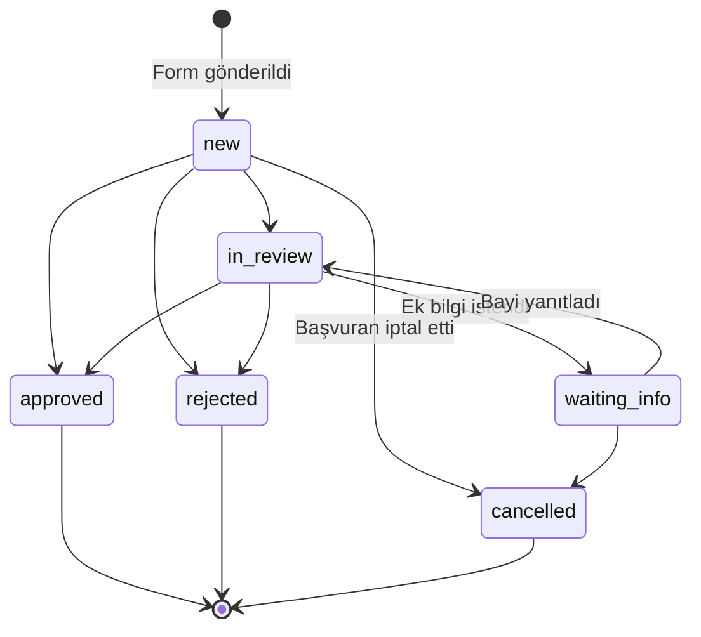
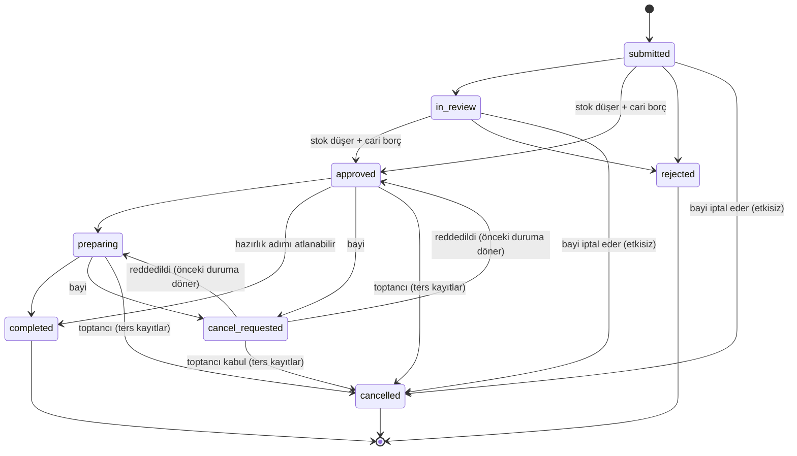

# Aşama 1 — İş Akışları ve Veri Tutarlılığı Kuralları

> Stok · Sipariş · Cari · Fiyat · Bayilik · Ürün talebi · E-posta
> Durum: **Onaylandı** (2026-10-15)

Bu kurallar kodun ve testlerin sözleşmesidir. Bir kural değişirse önce bu doküman güncellenir.

---

## 1. Bayilik başvurusu → bayi hesabı



1. Başvuru formu `/basvuru/{slug}` — rate limit (IP başına 5/saat), gizli bal küpü (honeypot) alanı, aydınlatma metni onayı ve metin sürümü kaydedilir. Belge eki isteğe bağlı (PDF/JPG/PNG, en fazla 5 MB, 3 dosya).
2. Aynı işletmeye aynı e-postayla açık (yeni / inceleniyor / ek bilgi) başvuru varsa yenisi oluşmaz.
3. **Onay** (tek transaction):
   - E-posta mevcut bir `dealer_users` kaydına aitse → mevcut `dealers` kullanılır (K11).
   - Değilse → `dealers` + `dealer_users` (parolasız) oluşturulur.
   - `dealer_relationships` (bayi kodu otomatik, işletme değiştirebilir) + `current_accounts` (bakiye 0) + boş `carts` oluşturulur.
   - Yeni hesapsa aktivasyon token'ı (72 saat, tek kullanım, yalnızca hash saklanır).
   - Başvuru `approved`, `audit_logs`.
   - Transaction **sonrası**: e-posta kuyruğa (aktivasyon linki veya "yeni toptancı bağlandı").
4. Red: gerekçe zorunlu; bayiye e-posta. Hesap oluşmaz.
5. Ret veya iptal edilmiş başvuru sahibi yeniden başvurabilir.

**Bayinin sipariş verebilmesi için:** `dealer_users.status = active` **ve** `dealer_relationships.status = active` **ve** `businesses.status = active`. Bu kontrol her istekte middleware'de ve sipariş Action'ında tekrar yapılır.

## 2. Stok

**Temel ilke:** `warehouse_stock.quantity` gerçek fiziksel stoktur ve yalnızca bir `stock_movements` kaydıyla **aynı transaction'da** değişir.

| Kural | Uygulama |
|---|---|
| S1 — Değişmezlik | Her (depo, ürün) için `warehouse_stock.quantity = SUM(stock_movements.quantity)`. Günlük kontrol görevi farkı raporlar (otomatik düzeltmez). |
| S2 — Negatif stok yok | Düşüm öncesi satır `FOR UPDATE` ile kilitlenir; yetersizse işlem reddedilir. Ayrıca `CHECK (quantity >= 0)`. |
| S3 — Hareketler silinmez | Yanlış hareket, ters yönlü yeni hareketle düzeltilir (açıklama + bağlantı). |
| S4 — Transfer | Tek transaction: kaynak depoda `transfer_out` (−), hedefte `transfer_in` (+), aynı `transfer_uuid`. Kaynak yetersizse ikisi de yazılmaz. |
| S5 — Sayım | Sayım taslağı oluşturulurken sistem miktarı kopyalanır; **uygulama anında** fark yeniden hesaplanır (sayım sırasında satış olduysa doğru fark yazılır). Fark kadar `count_adjust`. |
| S6 — Kilit sırası | Birden çok stok satırı kilitlenirken her zaman `product_id` artan sırada (kilitlenme/deadlock önleme). |
| S7 — Sepet ve sipariş stok ayırmaz | Sepette olmak veya sipariş oluşturmak stoğu değiştirmez. Stok **yalnızca sipariş onayında** düşer. |
| S8 — Kritik stok | `quantity <= critical_stock_level` → dashboard ve "Kritik stok" raporu. |

**Bayiye gösterilen stok** = varsayılan sevk deposundaki miktar (K3). Gösterim biçimi işletme ayarı (K4).

## 3. Sipariş

### 3.1 Durumlar

| Kod | Ekranda | Kim geçirir |
|---|---|---|
| `submitted` | Toptancıya iletildi | Bayi (sipariş oluşturur) |
| `in_review` | İnceleniyor | Toptancı (isteğe bağlı ara adım) |
| `approved` | Onaylandı (+ "Kısmi" işareti) | Toptancı |
| `rejected` | Reddedildi | Toptancı |
| `preparing` | Hazırlanıyor | Toptancı |
| `completed` | Tamamlandı | Toptancı |
| `cancel_requested` | İptal talebi | Bayi |
| `cancelled` | İptal edildi | Bayi (onay öncesi) / Toptancı |



Tanımsız her geçiş `InvalidOrderTransition` hatası verir. Durum değişikliği her zaman `order_status_history`'ye yazılır.

### 3.2 Sipariş oluşturma (bayi)

Tek transaction:

1. Bayi, ilişki ve işletme aktif mi?
2. Sepet satırları kilitlenir. Her kalem için: ürün aktif ve bayiye görünür mü; `miktar ≥ min_order_qty`; `miktar` `order_step`'in katı mı; birim küsurata izin vermiyorsa tam sayı mı.
3. **Anlık stok kontrolü** (kilitsiz okuma): sevk deposundaki miktar < istenen ise sipariş **oluşturulmaz**, kalem işaretlenir ve bayiye "Bu ürün için ürün talebi oluştur" seçeneği sunulur.
4. Fiyatlar sunucuda `PriceResolver` ile hesaplanır (§4); tarayıcıdan gelen fiyat **hiç okunmaz**.
5. Seçilen sevk adresi bayiye ait mi? Adres alanları siparişe **kopyalanır**.
6. `submit_token` (formla gelen tek kullanımlık UUID) UNIQUE → çift tıklama veya ağ tekrarı ikinci sipariş üretmez.
7. Sipariş + kalemler (ad, SKU, barkod, birim, KDV oranı, fiyat kaynağı **anlık görüntü** olarak) + durum geçmişi yazılır; sepet boşaltılır.
8. Commit sonrası: toptancıya bildirim + e-posta (kuyruk).

> **Not:** Rezervasyon olmadığı için oluşturma anındaki stok kontrolü yalnızca bilgilendiricidir. Bayi ekranında "Stok, sipariş onayında kesinleşir" notu bulunur. Fazla satışı engelleyen asıl kontrol onaydadır (§3.3).

### 3.3 Sipariş onayı (toptancı) — kritik transaction

```
BEGIN
  order = SELECT … FROM orders WHERE id=? AND business_id=? FOR UPDATE
  durum ∈ {submitted, in_review} değilse → hata ("Sipariş zaten işlenmiş")   ← çift onay engeli
  stock_applied_at IS NOT NULL ise → hata                                    ← ikinci savunma

  kalemler product_id artan sırada:
     stok = SELECT quantity FROM warehouse_stock
            WHERE warehouse_id=? AND product_id=? FOR UPDATE
     quantity_approved > stok ise → yetersizler listesine ekle

  yetersiz varsa → ROLLBACK; ekranda kalem kalem "İstenen / Mevcut" gösterilir.
     Toptancı: miktarı düşürüp (Kısmi) tekrar onaylar ya da reddeder.

  her kalem için:
     UPDATE warehouse_stock SET quantity = quantity - :q
     INSERT stock_movements(type='sale', quantity=-:q,
                            source_key='order:{id}:sale:{item_id}')         ← UNIQUE

  tutarlar onaylanan miktarlarla yeniden hesaplanır
     (birim fiyat ve KDV oranı SİPARİŞTEKİ anlık görüntüden; güncel fiyattan DEĞİL)

  ledger_post_on = 'approval' ise:
     SELECT … FROM current_accounts WHERE id=? FOR UPDATE
     INSERT current_account_movements(type='order_debit', debit=grand_total,
            due_date = bugün + vade günü, source_key='order:{id}:debit')     ← UNIQUE
     UPDATE current_accounts SET balance = balance + grand_total

  UPDATE orders SET status='approved', is_partial=?, stock_applied_at=NOW(),
                    ledger_applied_at=?, approved_by=?, delivery bilgileri
  INSERT order_status_history, audit_logs
COMMIT
→ commit sonrası: bayiye bildirim + e-posta (başarısız olsa da onay geri alınmaz)
```

**Garantiler**

- Onay ya **tamamen** olur (durum + stok + cari) ya da **hiç** olmaz.
- İki toptancı kullanıcısı aynı siparişi aynı anda onaylarsa: ikincisi sipariş satırı kilidinde bekler, kilit açılınca durumu `approved` görür ve hata alır.
- Aynı ürünü içeren iki farklı sipariş aynı anda onaylanırsa: stok satırı kilidi sıralar; ikinci onay güncel (düşmüş) stoğu görür. Stok yetmiyorsa reddedilir → **fazla satış olmaz**.
- Uygulama hatası olsa bile `source_key` UNIQUE kısıtı aynı siparişin stoğunun veya carisinin ikinci kez işlenmesini veritabanı seviyesinde engeller.

### 3.4 Red

Yalnızca `submitted` / `in_review` durumunda. Stok ve cari hareketi **oluşmaz** (zaten oluşmamıştır). Gerekçe zorunlu, bayiye iletilir.

### 3.5 İptal

| Sipariş durumu | Kim | Etki |
|---|---|---|
| `submitted`, `in_review` | Bayi doğrudan / Toptancı | Yalnızca durum. Stok/cari hareketi yok. |
| `approved`, `preparing` | Bayi → `cancel_requested`; toptancı kabul ederse `cancelled` | Ters kayıtlar (aşağıda) |
| `approved`, `preparing` | Toptancı doğrudan | Ters kayıtlar |
| `completed` | İptal yok | İade kaydı kullanılır (§3.6) |

Ters kayıt transaction'ı (onaydaki ile aynı kilit sırası):

- `stock_applied_at IS NOT NULL AND stock_reversed_at IS NULL` ise her kalem için `sale_reversal` (+), `source_key='order:{id}:sale_reversal:{item_id}'`.
- `ledger_applied_at IS NOT NULL AND ledger_reversed_at IS NULL` ise `reversal` alacak kaydı, `reverses_movement_id` = orijinal borç (UNIQUE), `source_key='order:{id}:debit_reversal'`.
- `stock_reversed_at`, `ledger_reversed_at` doldurulur.

→ İkinci iptal denemesi hem durum kontrolüne hem UNIQUE kısıtlara takılır; stok veya cari **iki kez etkilenmez**.

### 3.6 İade (tamamlanmış sipariş)

Toptancı siparişten "İade kaydı" açar: kalem ve miktar seçer (ilgili kalemde satılan − daha önce iade edilen miktarı aşamaz). Tek transaction: `return_in` stok hareketi + `return_credit` cari alacak (kalemin anlık fiyatı ve KDV'siyle). Siparişin durumu değişmez; sipariş detayında iade geçmişi görünür.

## 4. Fiyatlandırma

### 4.1 Öncelik (yüksekten düşüğe)

| Sıra | Kaynak | Sonuç |
|---|---|---|
| 1 | **Bayiye özel ürün fiyatı** (tarih aralığında geçerli) | Nihai net fiyat. Üzerine indirim **uygulanmaz**. |
| 2 | Bayi grubunun **fiyat listesindeki** fiyat (liste tarihi geçerli) | Taban fiyat |
| 3 | Ürünün **standart bayi fiyatı** | Taban fiyat |
| 4 | Ürünün **genel liste fiyatı** (bayi fiyatı tanımsızsa) | Taban fiyat |

Taban fiyat 2–4'ten geldiyse **tek bir indirim** uygulanır, şu sırayla ilk eşleşen:

1. Ürün bazlı indirim — bayiye özel → bayi grubuna → tüm bayilere
2. Kategori bazlı indirim — aynı sırayla; alt kategori, üst kategoriden önce gelir

Aynı seviyede birden çok geçerli kural varsa **en yüksek indirim** değil, **en son başlayan** kural uygulanır (öngörülebilir olsun diye); toptancı kural oluştururken çakışma uyarısı görür.

Genel liste fiyatı bayiye "liste fiyatı" olarak, uygulanan fiyatın yanında gösterilebilir. Alış fiyatı bayi tarafında hiçbir yanıtta (HTML, JSON, dışa aktarma) yer almaz.

### 4.2 KDV ve yuvarlama

- Ürün fiyatı "KDV dahil" girildiyse net fiyat `fiyat / (1 + oran)` ile **4 ondalığa** çevrilip saklanır; hesaplar hep net (KDV hariç) fiyattan yürür.
- Satır: `satır_net = yuvarla(birim_net × miktar × (1 − indirim%), 2)`; `satır_kdv = yuvarla(satır_net × oran, 2)`; `satır_toplam = satır_net + satır_kdv`.
- Sipariş toplamları = satırların toplamı (toplam üzerinden ayrıca yuvarlama yapılmaz).
- Yuvarlama: **HALF_UP** (yarım yukarı), her yerde aynı fonksiyon (`Money::round`).
- Ekranda, e-postada, raporda ve PDF'te aynı saklanmış değerler gösterilir; yeniden hesaplanmaz.

### 4.3 Fiyat değişikliğinin geçmişe etkisi

Yok. Sipariş kalemi fiyatı, KDV oranı, ürün adı ve kodunu kendi satırında taşır. Ürün güncellense, arşivlense veya KDV oranı değişse de geçmiş sipariş, ekstre ve rapor aynı kalır.

## 5. Stokta olmayan ürün talebi

- Bayi, sevk deposunda stoğu yetersiz olan ürün için talep oluşturur: miktar (> 0), açıklama, "stok gelince haber ver" seçimi.
- Aynı bayinin aynı ürün için açık talebi varsa yenisi açılmaz; mevcut talep güncellenir.
- Durumlar: `new → in_review → available | unavailable → stock_updated → closed`. Toptancı her durum değişikliğinde yanıt notu yazabilir; bayiye bildirim gider.
- Talep **stoğu değiştirmez, ürünü ayırmaz, siparişe dönüşmez.**
- Ürüne stok girişi yapıldığında (opening/increase/transfer_in/return_in/count_adjust +) commit sonrası bir iş, o ürün için `notify_when_in_stock` açık talepleri bulur; bayiye "ürün stokta" bildirimi/e-postası gönderir, `notified_at` doldurur. Bayi normal sipariş akışını kendisi başlatır.

## 6. Cari hesap

| Kural | Uygulama |
|---|---|
| C1 — Bakiye kaynağı hareketlerdir | `balance = SUM(debit) − SUM(credit)` (açılış dahil). `current_accounts.balance` yalnızca önbellektir ve hareketle **aynı transaction'da**, hesap satırı `FOR UPDATE` kilitliyken güncellenir. Günlük kontrol görevi farkı raporlar. |
| C2 — Hareket silinmez | Hata ters kayıtla düzeltilir (`reverses_movement_id` UNIQUE → bir hareket en fazla bir kez ters çevrilir). |
| C3 — Sipariş borcu tek | `source_key='order:{id}:debit'` UNIQUE. Ne zaman oluşacağı `ledger_post_on` ayarına bağlı (K5). |
| C4 — Tahsilat | Toptancı manuel girer: tarih, tutar (> 0), yöntem, isteğe bağlı sipariş, açıklama. Tek transaction: `collections` + `collection` alacak hareketi + bakiye. Ödeme sistemi açıksa bayinin kart ödemesi (iyzico) ve toptancının siparişte kaydettiği havale / nakit / POS ödemesi aynı yolla otomatik tahsilat yazar (docs/29-b2b-odeme-raporu.md). Sistem bankayı kontrol etmez. |
| C5 — Tahsilat iptali | Silinmez; `cancelled_at` + gerekçe + `reversal` hareketi. |
| C6 — Açılış bakiyesi | İlişki başına bir kez (`source_key='opening:{account_id}'`); düzeltmesi `adjustment_*` ile. |
| C7 — Manuel düzeltme | Açıklama zorunlu, `audit_logs`'a yazılır. |
| C8 — Vade | Borç hareketi `due_date = hareket tarihi + ilişkinin vade günü`. |
| C9 — Vadesi geçmiş tutar | Rapor anında **FIFO eşleştirme** ile hesaplanır: alacaklar (tahsilat, iade, ters kayıt) en eski borçtan başlayarak kapatılır; kapanmamış ve `due_date < bugün` olan borç kalanları "vadesi geçmiş" sayılır. Saklanmaz, her zaman hareketlerden türetilir. |

Cari modül resmî muhasebe veya yasal defter değildir; bu not ekstre ve rapor başlıklarında yer alır.

## 7. Sevk adresi ve teslimat

- Bayi birden çok adres kaydeder, birini varsayılan yapar. İlişkide `can_edit_addresses = false` ise bayi yalnızca mevcut adresleri seçebilir; değişikliği mesajla toptancıdan ister.
- Siparişte adresin **kopyası** saklanır; adres sonradan değişse/arşivlense sipariş etkilenmez.
- Toptancı onay ekranında teslim alacak kişi, telefon, teslimat notu ve planlanan teslimat tarihini düzenleyebilir (siparişteki kopya üzerinde; bayinin adres defteri değişmez).
- Kargo firması, takip numarası, kargo ücreti **yoktur**. "Hazırlanıyor" ve "Tamamlandı" iç operasyon durumlarıdır.

## 8. E-posta gönderimi

- Gönderim her zaman **kuyrukta** ve ilgili iş transaction'ı **commit edildikten sonra** yapılır. E-posta hatası siparişi, onayı veya başvuruyu asla geri almaz.
- Her gönderim `email_logs`'a yazılır. Başarısızlıkta 3 deneme (1, 5, 30 dk); sonra `failed` — toptancı listeden tekrar gönderebilir.
- Bağlantı: `smtp.gmail.com:587`, STARTTLS, kimlik doğrulama, kullanıcı adı = gönderen e-posta, parola = çözülen uygulama şifresi. Kullanıcıdan sunucu/port/şifreleme **istenmez**.
- "Bağlantıyı test et": adres doğrulanır → SMTP bağlantı + kimlik doğrulama denenir → kullanıcıya anlaşılır sonuç ("Google uygulama şifresini kabul etmedi", "Sunucuya bağlanılamadı") → ham sunucu yanıtı ve şifre hiçbir yere yazılmaz. Başarılıysa kullanıcının kendi adresine test e-postası.
- Kayıtlı şifre geri gösterilmez: ekranda "E-posta yapılandırıldı ✓ — son test: …" ve "Yeni uygulama şifresi gir" alanı.

## 9. Eşzamanlılık ve tekrar koruması — özet tablo

| Risk | Koruma |
|---|---|
| Çift tıklama ile iki sipariş | `orders.submit_token` UNIQUE |
| Aynı siparişin iki kez onayı | Sipariş satırı `FOR UPDATE` + durum kontrolü + `stock_applied_at` |
| Eşzamanlı onaylarda fazla satış | `warehouse_stock` satırı `FOR UPDATE`, sabit kilit sırası, `CHECK quantity >= 0` |
| Yinelenen stok düşümü | `stock_movements.source_key` UNIQUE |
| Yinelenen cari borç / ters kayıt | `current_account_movements.source_key` UNIQUE, `reverses_movement_id` UNIQUE |
| İptalin iki kez işlenmesi | Durum kontrolü + `*_reversed_at` + UNIQUE source_key |
| Formdan sahte fiyat | Fiyat yalnızca sunucuda hesaplanır |
| Başka işletmenin kaydı | Tenant scope + bileşik FK + 404 |
| E-posta hatasının işlemi bozması | Commit sonrası kuyruk |

## 10. Bu kuralları doğrulayacak testler (Aşama 5–9)

- Aynı ürün stoğu 10, iki sipariş 7'şer adet → iki ayrı PHP sürecinde **paralel** onay: biri onaylanır, diğeri "yetersiz stok" alır; son stok 3, tek `sale` hareketi.
- Aynı sipariş paralel iki onay → tek onay, tek stok hareketi, tek cari borç.
- Onaylı sipariş iki kez iptal → stok ve bakiye yalnızca bir kez geri döner.
- Onay transaction'ının ortasında hata (test için zorlanmış) → sipariş `submitted` kalır, stok ve bakiye değişmez.
- Ürün fiyatı ve KDV oranı değişir → eski siparişin tutarı, ekstresi ve PDF'i aynı kalır.
- Her (depo, ürün) için stok = hareket toplamı; her cari için bakiye = hareket toplamı (test sonunda tüm veritabanı üzerinde doğrulanır).
- B işletmesinin sipariş, bayi, cari, mesaj, dosya ID'leri A işletmesi oturumuyla → 404.
- Bayi X, bayi Y'nin siparişini/carisini/adresini görüntüleyemez.
